  

  
  
  

  I design and operate critical infrastructure — from bare-metal to multi-cloud, from e-commerce to air traffic control. 
  Security embedded at every stage of the pipeline. <b>No heroics: engineering, evidence and automation.</b>

<picture>
  <source media="(prefers-color-scheme: dark)" srcset="https://raw.githubusercontent.com/acrispim/acrispim/output/snake-dark.svg">
  <source media="(prefers-color-scheme: light)" srcset="https://raw.githubusercontent.com/acrispim/acrispim/output/snake.svg">
  
</picture>
