  

  
  
  

  Projeto e opero infraestrutura crítica há 6+ anos — de bare-metal a multi-cloud, de e-commerce a controle de tráfego aéreo. 
  Segurança embutida em cada estágio do pipeline. <b>Sem heroísmo: engenharia, evidência e automação.</b>

<picture>
  <source media="(prefers-color-scheme: dark)" srcset="https://raw.githubusercontent.com/acrispim/acrispim/output/snake-dark.svg">
  <source media="(prefers-color-scheme: light)" srcset="https://raw.githubusercontent.com/acrispim/acrispim/output/snake.svg">
  
</picture>
